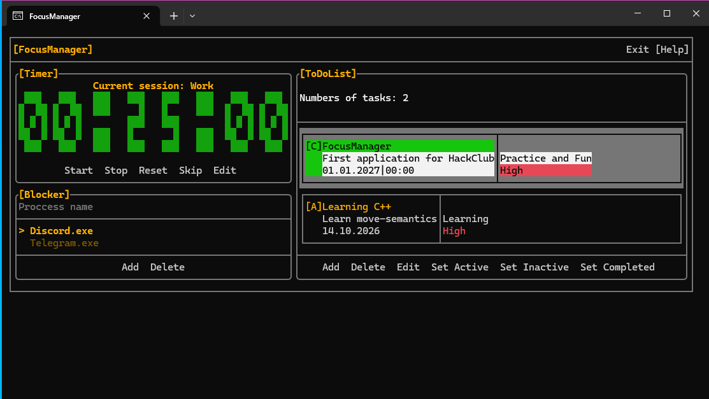
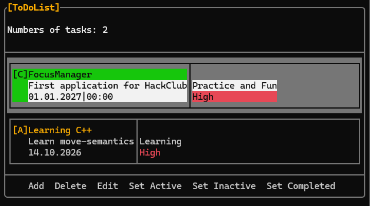
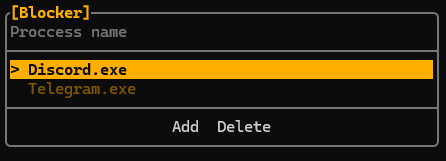
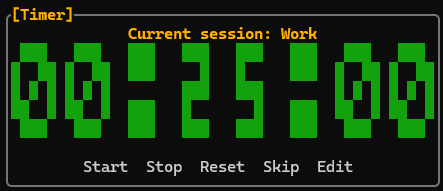
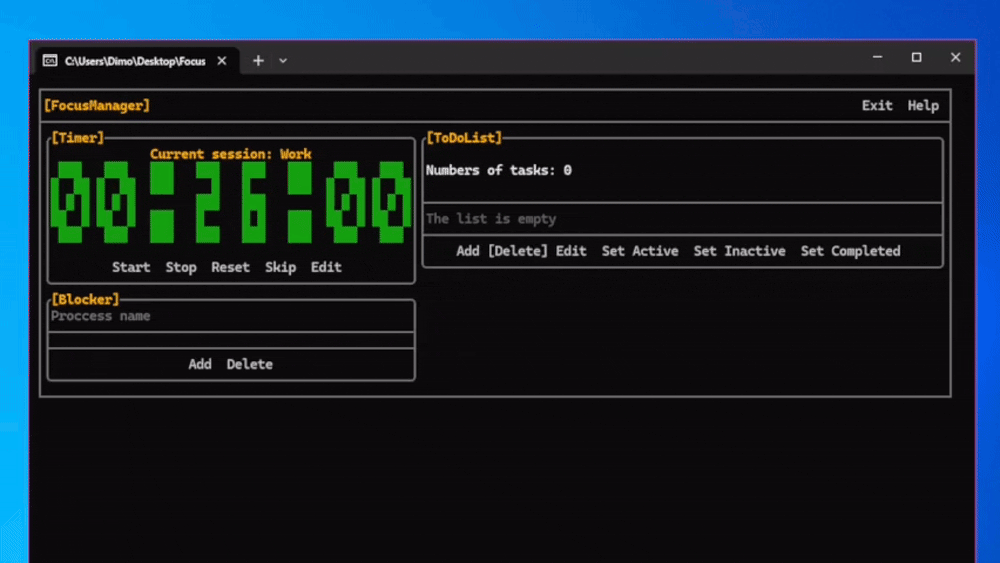

# FocusManager

**FocusManager is a Windows application designed to help you stay focused, manage your tasks, and reduce distractions while working or studying.**

The project started as a personal solution to a problem I struggled with: getting distracted by unrelated things when I was supposed to be working on something important. I wanted to build a tool that would help me organize my work and make it easier to stay focused.

What began as a way to solve my own problem became a project I could continue improving, experiment with, and potentially turn into a more customizable productivity tool.

> My goal is to make staying focused easier, not to create another complicated productivity system.

---

## Table of Contents

- [Features](#features)
- [Screenshots](#screenshots)
- [How It Works](#how-it-works)
- [Installation](#installation)
- [Requirements](#requirements)
- [Known Limitations](#known-limitations)
- [Roadmap](#roadmap)
- [Future Ideas](#future-ideas)
- [Suggest an Idea](#suggest-an-idea)
- [Technologies](#technologies)
- [Contributing](#contributing)
- [License](#license)

## Features

FocusManager brings several productivity-related tools together in one application.

- **Task management** — organize the tasks you need to complete.
- **Focus timer** — set a timer in minutes to dedicate a period of time to a task.
- **Blocker** — use the built-in blocking functionality to help reduce distractions.
- **Simple interface** — access the application's functionality through clickable buttons and input fields.
- **Windows support** — designed to run on Windows 10 and Windows 11.
- **Local data persistence** — save application data when exiting through the designated Exit button.

The application is still evolving. Some features and workflows may be improved or redesigned in future releases.

## Screenshots

Here are some screenshots of FocusManager in action.

### Main Window

*The main interface of FocusManager.*

### Task Management

*An overview of the task management interface.*

### Blocker

*The Blocker interface.*

### Focus Timer

*The focus timer.*

If a feature is not shown in your current version, simply remove its screenshot section. You can also add more screenshots as the application grows.

## How It Works

The following GIF demonstrates the application and its current workflow.

  

FocusManager is intended to provide a straightforward way to organize tasks and spend time on them with fewer distractions.

The current version includes several productivity tools, while future versions may introduce a more flexible architecture, additional functionality, and improved usability.

<b>Important Notes About the Current Version</b>

- All buttons in the interface are clickable.
- Date and time input fields do not currently validate whether the entered values or their order are correct.
- Application data is saved only after clicking the **Exit** button. Make sure to exit through the application rather than closing it unexpectedly.
- In the Blocker, always enter the program's extension as required by the current implementation.
- The timer expects the duration to be entered in minutes.

These limitations may be addressed in future releases.

## Installation

You can install FocusManager using the latest release available on GitHub.

1. Open the repository's **Releases** tab.
2. Select the latest FocusManager release.
3. Under **Assets**, download the installer with the `.exe` extension, for example, `FocusManager-Setup-1.1.0.exe`.
4. Run the downloaded installer.
5. Windows SmartScreen may display a warning if the application is not recognized or lacks a recognized digital signature. Verify that the installer comes from the official project release before deciding whether to proceed.
6. If Windows requests permission to make changes to your device, review the prompt and approve it if appropriate.
7. Follow the Inno Setup installation wizard, select your preferred options, and click **Install**.
8. Once the installation is complete, click **Finish**.

After installation, you can launch FocusManager from the Windows Start menu or the desktop shortcut, if one was created.

**Note:** The example installer filename is illustrative. The files available in the latest release may differ.

## Requirements

- Windows 10 or Windows 11.
- A compatible Windows computer.
- Windows Terminal is recommended, although the regular Windows console can also be used where needed.

## Known Limitations

FocusManager is an ongoing personal project, and the current version has some limitations.

- Input validation for dates and times needs improvement.
- Saving data depends on using the application's Exit button.
- The current architecture does not yet provide the planned plugin system.
- More extensive testing and optimization are planned.
- The interface and overall user experience can be improved further.

Identifying these limitations helps establish what should be prioritized in future development.

## Roadmap

My next goal is to make FocusManager more flexible, reliable, and useful for different workflows.

### Planned Improvements

- [ ] **Redesign the application architecture** to make it easier to extend and maintain.
- [ ] **Introduce a plugin system** so new functionality can be added without rewriting large parts of the application.
- [ ] **Develop several plugins** that demonstrate what the plugin system can do.
- [ ] **Write a plugin development guide** explaining how other developers can create and integrate their own plugins.
- [ ] **Improve performance and optimize the application**, including identifying inefficient parts of the current implementation.
- [ ] **Improve input validation** for dates, times, and other user-provided values.
- [ ] **Improve data persistence** to reduce the risk of losing changes.
- [ ] **Improve the user interface and usability** based on feedback.
- [ ] **Expand testing** to make the application more reliable.

The exact order of implementation may change as development progresses.

## Future Ideas

In addition to the planned improvements, there are several features I would like to explore.

### Website Blocker

A website blocker could help users avoid distracting websites during focus sessions. Ideally, users would be able to configure which websites to block and when blocking should be active.

### Eisenhower Matrix

An Eisenhower Matrix could help users prioritize tasks according to two criteria:

- **Urgency** — how soon does the task need attention?
- **Importance** — how much does the task contribute to a goal?

This would provide four categories: do first, schedule, delegate, and eliminate. It could help users decide what deserves their attention instead of simply working through a task list.

### Plugin Ecosystem

A plugin system could allow FocusManager to support additional features without requiring every feature to be built directly into the core application.

Possible plugins include:

- Website blocking.
- Pomodoro-style focus sessions and breaks.
- Task statistics and productivity reports.
- Customizable reminders.
- Additional task organization tools.
- Integrations with external productivity services.

These are ideas for future development, not promises that every feature will be implemented.

## Why I Started This Project

I started FocusManager because I often found myself getting distracted by unrelated activities when I needed to concentrate on something important.

It can be difficult to stay focused when there are so many things competing for your attention. I wanted to try solving that problem by building something of my own instead of relying entirely on existing tools.

Working on FocusManager also gives me an opportunity to learn more about software development, improve my C++ skills, and understand how to structure a project so that it can grow over time.

One of the things I would like to achieve is to move beyond a simple personal application and build something that other people can adapt to their own needs. That is one of the main reasons I want to introduce plugins and make the project easier to extend.

FocusManager is still a work in progress, and there is plenty of room for improvement. Feedback, suggestions, and contributions can help determine what the project becomes next.

## Suggest an Idea

**Have an idea that could make FocusManager more useful? I'd love to hear it!**

You do not need to be a developer to suggest a feature. If you think something would help you concentrate, organize tasks, or reduce distractions, your suggestion is welcome.

You can share your ideas through:

- **GitHub Issues** — report bugs, describe problems, or propose new features.
- **GitHub Discussions** — share ideas and discuss possible improvements, if Discussions are enabled for this repository.
- **Pull Requests** — contribute code, documentation, or other improvements if you want to help develop the project.

When suggesting a feature, it helps to explain the problem it would solve and how you imagine it working.

I'd especially appreciate feedback about the planned plugin system, website blocking, task prioritization, and performance improvements.

## Technologies

- **C++20 or later** — the programming language used for the project.
- **Windows 10/11** — the target operating system.
- **Inno Setup** — used to package the application installer.

The technology list may expand as the project develops.

## Contributing

Contributions and constructive feedback are welcome!

If you would like to contribute:

1. Check the existing issues to see what is already being discussed.
2. Open an issue before starting a major change, especially if it involves the architecture or a new feature.
3. Describe your proposed change and why it would be useful.
4. Submit a pull request if you have implemented an improvement.

As the plugin architecture develops, I also plan to provide documentation to make it easier for other developers to extend FocusManager with their own plugins.

## License

FocusManager is distributed under the MIT License.

See [LICENSE.txt](LICENSE.txt) for the full license text.
